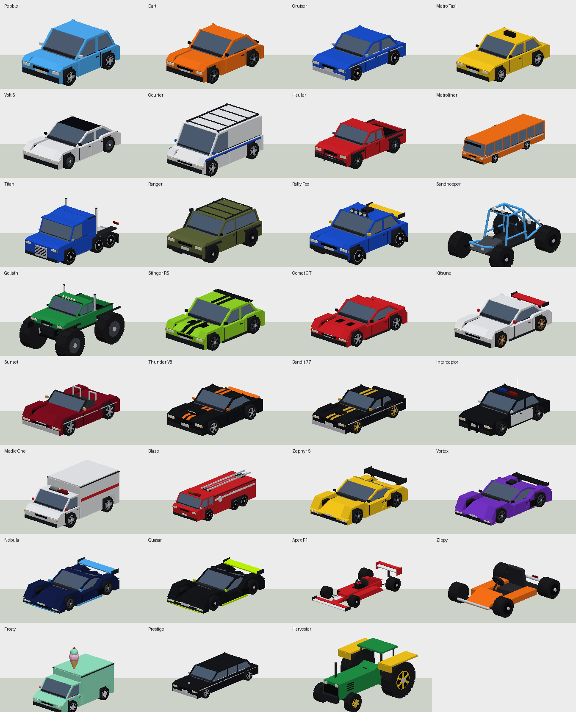
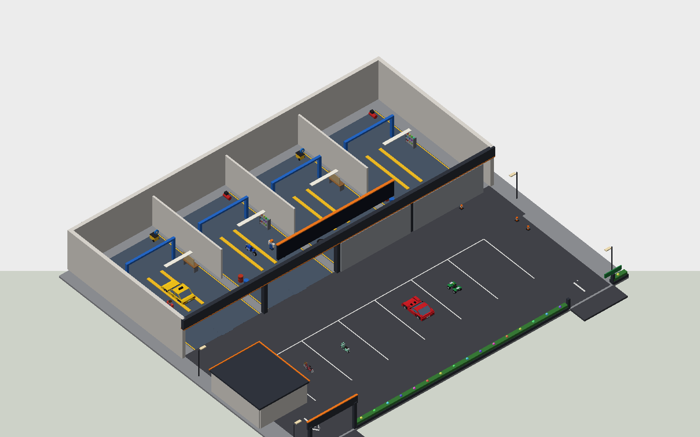
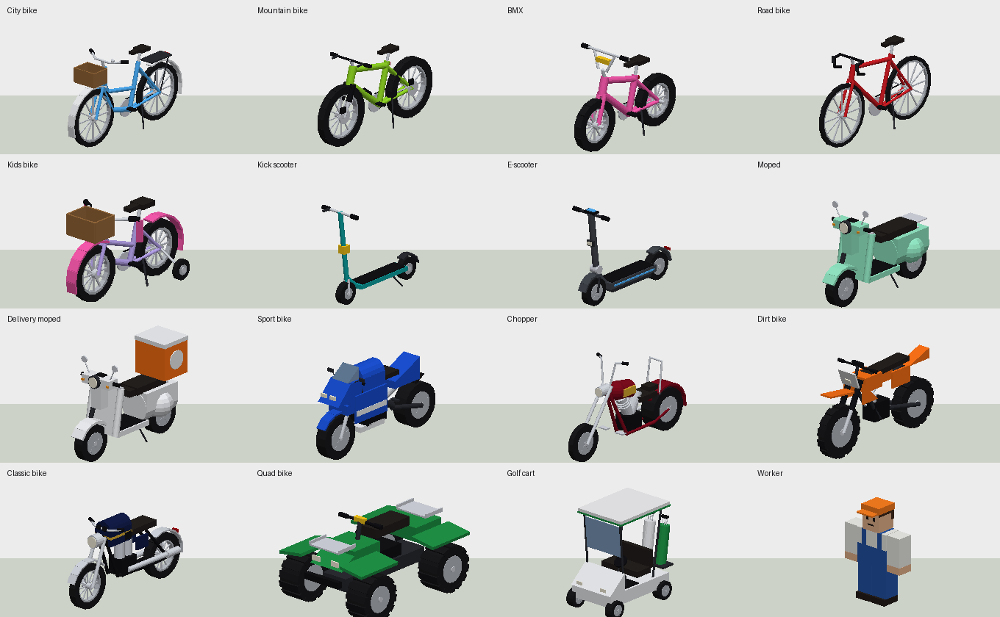
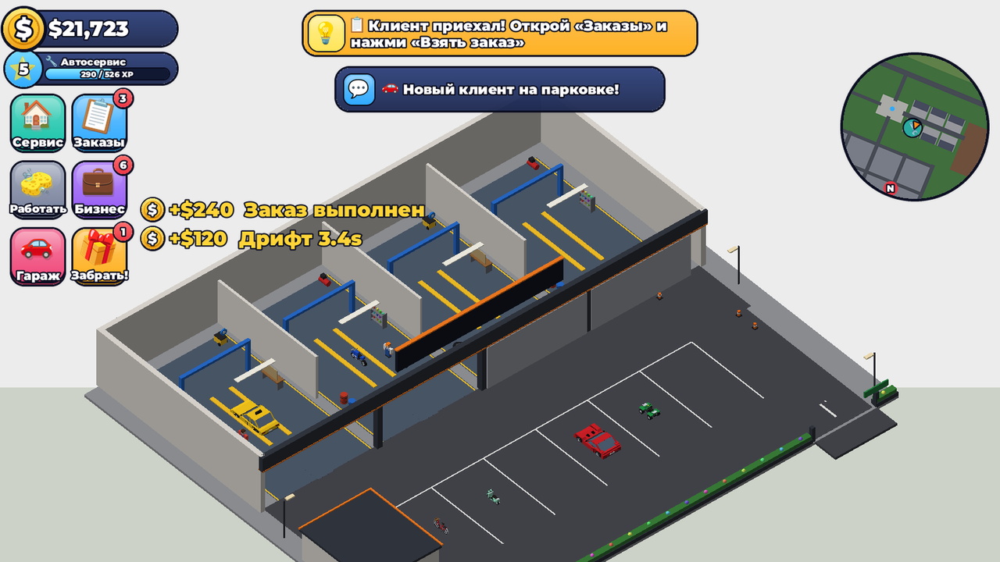
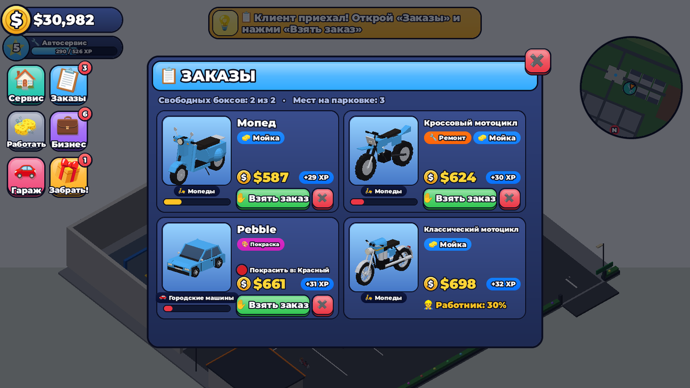
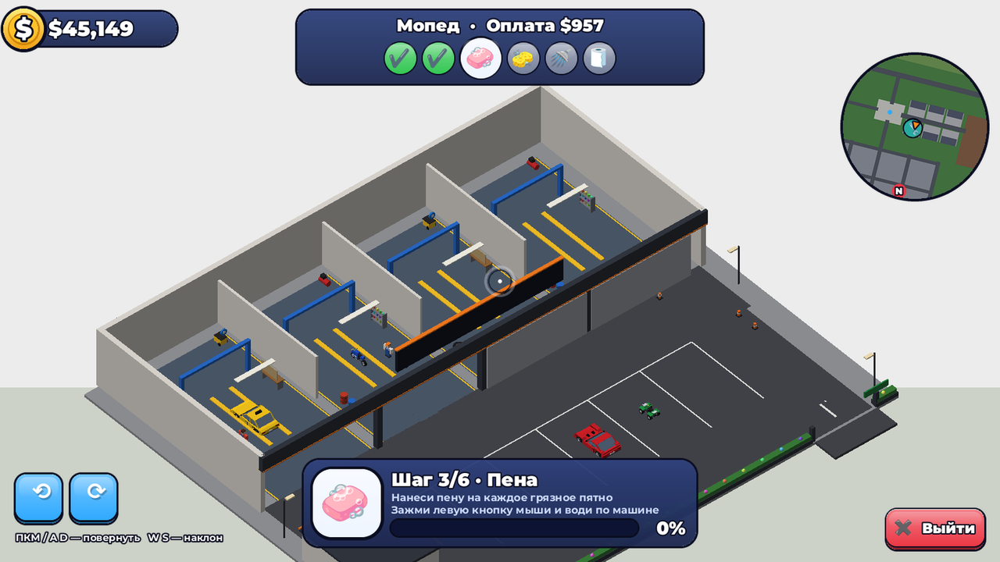
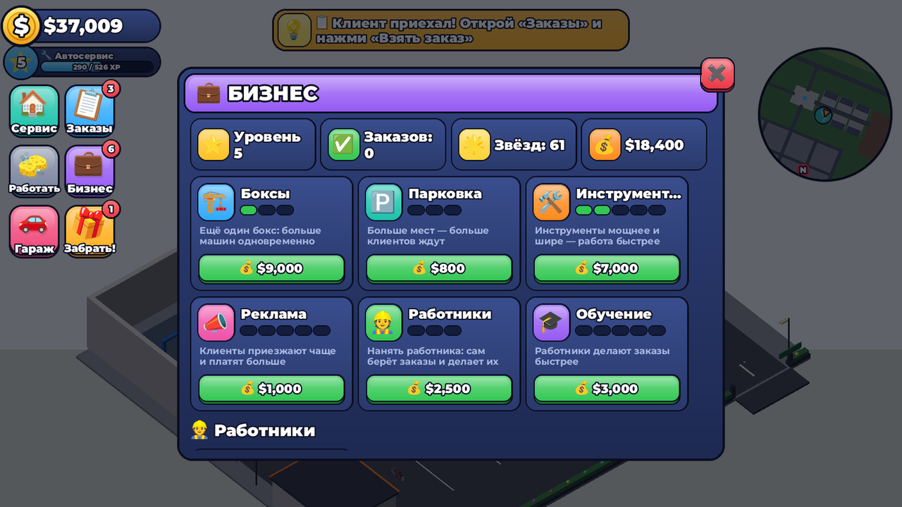
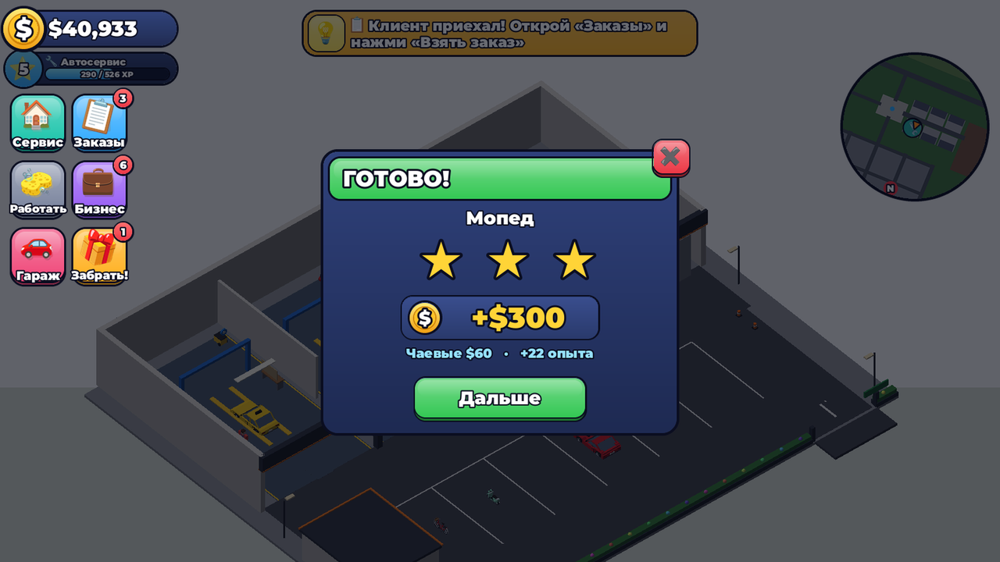
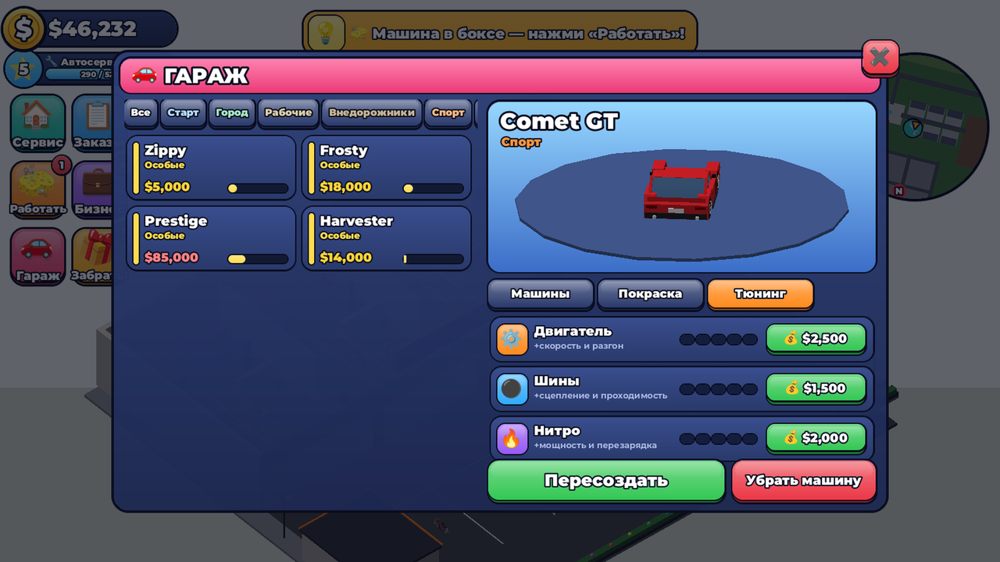
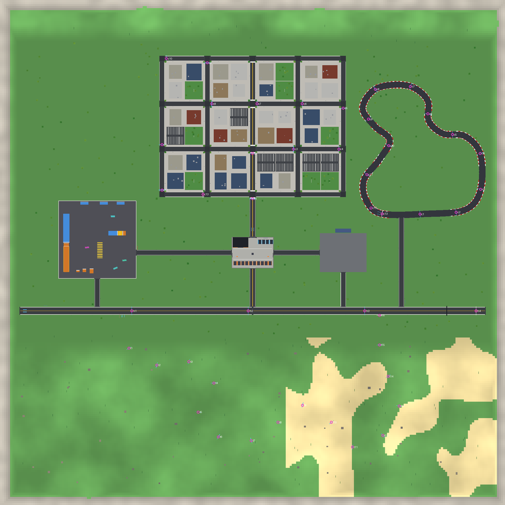

# Cars — автомобильный режим для Roblox

Открытый мир с машинами: 31 модель в 10 классах, аркадная физика с дрифтом и нитро,
город, кольцевая трасса, стант-парк, дрифт-арена, шоссе с радаром скорости и
бездорожье в дюнах. Гонки на время с медалями и мировыми рекордами, гараж с
покраской и тюнингом, сохранения прогресса. Интерфейс на русском и английском
(выбирается автоматически по языку игрока).



## Автосервис — главный новый режим

У каждого игрока свой автосервис на западной улице (6 участков рядом с площадью).
Клиенты сами заезжают на парковку с заказом, а всю работу вы делаете **руками**:

1. **Клиент приехал** — над машиной видно, что нужно (🧽 мойка, 🔧 ремонт, 🎨 покраска) и сколько заплатят.
2. **«Заказы» → «Взять заказ»** (или кнопка **E** у машины) — машина сама заезжает в свободный бокс.
3. **«Работать»** — камера наводится на машину, внизу большая карточка с инструментом и подсказкой.
   Зажмите левую кнопку мыши (на телефоне — палец) и водите по машине:
   - **мойка**: пена 🧼 на грязь → губка 🧽 → смыть водой 🚿 → вытереть 🧻;
   - **ремонт**: найти поломки ⚠ и закрутить ключом 🔧 → накачать каждое колесо 💨 до 100%;
   - **покраска**: зашкурить ржавчину 🧤 → покрасить каждую деталь кузова в цвет из заказа 🎨.
   Поворот камеры — правая кнопка мыши, A/D или стрелки на экране; колесо мыши — приближение.
4. **Готово!** — деньги, опыт и до 3 звёзд (быстрая работа = чаевые до +25%).

**Уровни** открывают новых клиентов: велосипеды → самокаты → мопеды → мотоциклы →
квадроциклы и гольф-кары → городские машины → рабочие → спорткары → люкс и суперкары →
гиперкары → автобусы и грузовики, а также новые услуги (ремонт со 2-го уровня, покраска с 4-го).

**Бизнес** (кнопка «Бизнес» или стол в офисе): новые боксы (до 4), места на парковке,
инструменты (работа быстрее), реклама (клиенты чаще и щедрее), **работники** (с 4-го уровня:
сами берут заказы, которые ждут дольше 8 секунд, и делают их — вы получаете 70%) и их обучение.



15 новых моделей, нарисованных кодом: городской, горный, детский, шоссейный велосипеды и BMX,
самокат и электросамокат, мопед и мопед доставки, спортбайк, чоппер, кроссовый и классический
мотоциклы, квадроцикл, гольф-кар — плюс работники в комбинезонах и реквизит мастерской
(подъёмники, мойки высокого давления, ящики с инструментами, шины, бочки, компрессоры, полки с краской).



## Интерфейс

Весь интерфейс нарисован кодом в «игрушечном» стиле топовых игр Roblox: объёмные кнопки с
тёмной обводкой, глянцевым бликом и «губой» снизу (кнопка вдавливается при нажатии), большие
плитки-иконки слева (Сервис, Заказы, Работать, Бизнес, Гараж, Награда) с красными счётчиками,
монетки рядом с ценами, окна с цветной шапкой и красным крестиком на углу, карточки заказов
с 3D-превью машины. Для русского языка используется жирный Gotham (в FredokaOne нет кириллицы),
для английского — FredokaOne.

| | |
| --- | --- |
|  |  |
|  |  |
|  |  |

Скриншоты сделаны без Roblox Studio: тест `tests/client.spec.luau` сохраняет дерево интерфейса,
а `tools/render_ui.py` рисует его (раскладки, скругления, обводки, градиенты, текст, эмодзи и
3D-превью) — так каждое изменение интерфейса можно проверить картинкой.

## Быстрый старт

**Вариант 1 — готовое место (проще всего).**
Скачайте [`build/CarsGame.rbxlx`](build/CarsGame.rbxlx), откройте его в Roblox Studio
(File → Open from File) и нажмите **Play**. Карта строится при запуске сервера
(2–4 секунды).

**Вариант 2 — добавить в своё существующее место.**
1. В Studio: правый клик по `Workspace` → *Insert from File…* → [`build/CarsMode.rbxmx`](build/CarsMode.rbxmx).
2. В Command Bar (View → Command Bar) выполните:
   ```lua
   require(workspace.CarsModeInstall.Installer)()
   ```
   Установщик разложит `CarsShared`, `CarsAssets`, `CarsServer`, `CarsClient` по сервисам.
   Если что-то с таким именем уже было — оно сохранится как `<Имя>_old`, ничего не удаляется.

**Вариант 3 — Rojo (для разработки).** Установите [Rokit](https://github.com/rojo-rbx/rokit),
выполните `rokit install`, затем `rojo serve` и подключитесь плагином Rojo в Studio.

**Сохранения в Studio.** Чтобы прогресс сохранялся при тестах, включите
*Game Settings → Security → Enable Studio Access to API Services* (место должно быть
опубликовано). Без этого игра работает в режиме сессии и пишет об этом в уведомлении.
В Studio доступна кнопка «+100 000» для тестирования (у обычных игроков её нет).

## Управление

| Действие | Клавиатура | Геймпад | Телефон |
| --- | --- | --- | --- |
| Газ / тормоз / задний ход | W / S | RT / LT | джойстик |
| Руль | A / D | левый стик | джойстик |
| Ручник (дрифт) | Пробел | X | кнопка |
| Нитро | Shift | RB | кнопка |
| Перевернуть машину | R | D-pad ↑ | кнопка |
| Выйти из машины | F | B | кнопка |
| Фары / сирена / гудок | L / K / H | D-pad → / ← / L3 | — |
| Камера | V | R3 | — |
| Гараж | G | Select | кнопка в углу |
| Работа в боксе | зажать ЛКМ и водить | — | водить пальцем |
| Повернуть камеру в боксе | ПКМ, A/D, W/S, колесо | — | кнопки ⟲ ⟳ |
| Выйти из бокса | Esc или «Выйти» | — | кнопка «Выйти» |

Сесть в машину — подойти к двери и нажать **E** (водитель — только владелец,
пассажирами могут быть все: в автобусе 8 мест, в лимузине 6).

## Что есть в игре

- **31 машина**: хэтчбеки, седаны, такси, электроседан, фургон, пикап, автобус, тягач,
  внедорожник, раллийный хэтчбек, багги, монстр-трак, спорткупе, дрифт-купе, родстер,
  маслкары, полиция (с мигалками), скорая, пожарная машина с лестницей, суперкары,
  гиперкары, болид F1, карт, фургон с мороженым, лимузин и трактор. Все модели
  собираются из деталей кодом (`CarBuilder`) — с арками колёс, стёклами, фарами,
  спойлерами, номерами с именем владельца и т.д.
- **Физика** (`CarPhysics`): подвеска на лучах, шины с «кругом трения», вес и
  перенос нагрузки, ассистент дрифта с автоконтррулём, нитро, управление в воздухе,
  разные покрытия (асфальт, трава, песок, грязь, лёд). Работает одинаково при 30, 60
  и 144 FPS — проверено тестами.
- **Мир**: площадь-автосалон с витриной, город из 12 кварталов с небоскрёбами,
  кольцевая трасса «Гран-при», стант-парк (прыжок через автобусы, мега-рампа,
  четверть-трубы), дрифт-арена с конусами, шоссе длиной 3600 стадов с радаром скорости,
  холмы и дюны с грунтовой трассой, смена дня и ночи с фонарями.
- **Гонки**: «Гран-при» (2 круга), «Городской спринт», «Тропа дюн», «Рывок по шоссе».
  Обратный отсчёт, чекпоинты со стрелкой-подсказкой, медали (золото/серебро/бронза),
  личные рекорды и мировые таблицы на площади. Античит: время между чекпоинтами
  проверяется сервером.
- **Экономика**: деньги за пробег, дрифт (×2 на арене), полёты (×2 в стант-парке),
  рекорды радара, гонки и ежедневную награду с серией дней.
- **Интерфейс**: спидометр с передачами, оборотами и нитро, счётчики дрифта и полёта,
  мини-карта (вращается с камерой, показывает машины игроков и следующий чекпоинт),
  экран загрузки, уведомления о наградах.
- **Гараж**: покупка машин, 24 цвета для кузова/акцентов/дисков, 6 покрытий
  (глянец, мат, металлик, перламутр, хром, неон), неоновая подсветка днища,
  тюнинг двигателя, шин и нитро (по 5 уровней).
- **Сохранения**: DataStore с блокировкой сессии, автосохранением, сохранением при
  выходе и выключении сервера, версиями схемы и защитой от потери данных (уровень,
  опыт и улучшения автосервиса тоже сохраняются).



## Как добавить свою машину

Откройте [`src/shared/CarCatalog.luau`](src/shared/CarCatalog.luau), скопируйте запись
похожей машины, поменяйте `id`, имя, цену, характеристики и размеры кузова. Модель,
физика, гараж и магазин подхватят её автоматически.

Чтобы использовать **свою готовую модель** (меши, детали из Studio): положите её в
`ReplicatedStorage.CarsAssets.Cars` (или файлом `.rbxm` в папку [`assets/Cars`](assets/Cars))
и добавьте в запись машины `customModel = "ИмяМодели"`. Точка опоры модели — на уровне
земли в центре машины, перед смотрит в −Z. Колёса, сиденья, физику и свет игра добавит
сама. Детали с именем `Paint`/`Accent` будут перекрашиваться в гараже.

## Звуки

Звуков по умолчанию нет (в Roblox нельзя гарантировать публичные ID). Вставьте ID
из Creator Store в `Config.Sounds` в [`src/shared/Config.luau`](src/shared/Config.luau) —
двигатель (высота тона зависит от оборотов), гудок, сирена и т.д.

## Структура проекта

```
src/shared/     → ReplicatedStorage.CarsShared   (каталог, физика, генератор машин, конфиг, тексты,
                                                  ServiceConfig/ServiceModels — автосервис)
src/server/     → ServerScriptService.CarsServer (системы: сохранения, мир, машины, магазин, гонки…)
src/client/     → StarterPlayerScripts.CarsClient (HUD, гараж, вождение, эффекты, гонки)
assets/         → ReplicatedStorage.CarsAssets   (свои модели машин)
tests/          тесты на Luau: генерация всех машин, физика, сервер, клиент
tools/          сборка, тесты, рендер превью, установщик
build/          готовые файлы для Studio
```

## Разработка

```bash
tools/test.sh      # все тесты (нужен Rust/cargo для сборки маленького Luau-раннера)
tools/build.sh     # собрать build/CarsGame.rbxlx и build/CarsMode.rbxmx (нужен rojo)
tools/render.sh    # перерисовать картинки в docs/ (python3 + numpy + pillow + fonttools)
selene src         # линтер
stylua src tests   # форматирование
```

Карту можно «запечь» в место, чтобы смотреть и править её в Studio: в Command Bar
выполните `require(game.ServerScriptService.CarsServer.Systems.World).bake()` и
сохраните место — сервер больше не будет строить её заново.

Подробности архитектуры для разработчиков и для Claude Code — в [CLAUDE.md](CLAUDE.md).

## Как продолжить на ПК (перенести старые наработки)

Вся работа лежит в ветке `claude/upbeat-hypatia-dmnicj`. На ПК откройте Claude Code
в папке, где лежат ваши прошлые файлы по машинам, и напишите, например:

> Склонируй (или обнови) репозиторий `tabwwwq/cars`, ветку `claude/upbeat-hypatia-dmnicj`.
> Прочитай `CLAUDE.md`, найди на этом ПК все мои старые наработки по машинам и режиму cars
> и перенеси их в проект по разделу «Merging work from the user's PC»: скрипты — в системы
> и контроллеры, модели машин — в `assets/Cars` с `customModel` в каталоге. Ничего не удаляй,
> прогони тесты, пересобери `build/`, закоммить и запушь.

Что уже предусмотрено для слияния:
- любые новые модули в `src/server/Systems` и `src/client/Controllers` подхватываются
  автоматически (функции `init`/`start`);
- свои модели машин подключаются через `customModel` (см. выше);
- установщик в Studio ничего не удаляет: старые папки остаются с суффиксом `_old`;
- папки называются `CarsShared`/`CarsServer`/`CarsClient`, чтобы не пересекаться с вашими.
